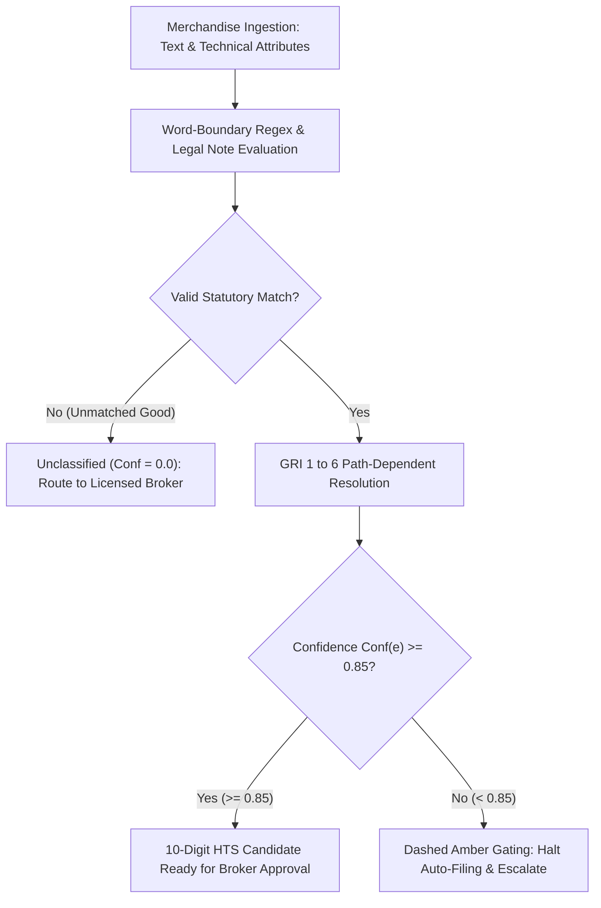

# 📄 Technical Architecture Whitepaper (v2.0)
## Deterministic Trade Compliance Engineering: Python Decimal Invariants, Fail-Closed Classification Gating, and Cycle-Safe Corporate Sanctions Graphs

> **Author:** Samuel Rencken  
> **Academic Foundation:** BCom in Economic Sciences (International Trade), North-West University (NWU)  
> **Role:** Principal AI Systems Architect & Lead TradeTech Engineer  
> **Interactive Web Edition:** [https://sssammyboyyy.github.io/trade-systems-studio/whitepaper/](https://sssammyboyyy.github.io/trade-systems-studio/whitepaper/)  
> **Live Console:** [https://sssammyboyyy.github.io/trade-systems-studio/](https://sssammyboyyy.github.io/trade-systems-studio/)  
> **Open Source Codebase:** [https://github.com/sssammyboyyy/trade-systems-studio](https://github.com/sssammyboyyy/trade-systems-studio)  
> **Verification Status:** 260/260 Automated Pytest Tests Passing (Python 3.11 & 3.12) | Next.js 15.5.29 | MIT License  

---

## 1. Abstract

Commercial trade operations and customs compliance represent an asymmetric operational surface: mid-market enterprise importers lose **5% to 15% of total freight expenditure** to carrier billing leakage and face severe civil monetary penalties under **19 U.S.C. § 1592 ($100k to $2.4M+)** due to line-item arithmetic discrepancies, assist omissions under 19 CFR § 152.103, and Harmonized Tariff Schedule (HTS) misclassifications.

Naive generative AI wrappers fail in regulated international trade because probabilistic language models hallucinate statutory citations, introduce binary floating-point rounding drift, and fail open on missing data or unrecognized commodities.

This paper documents the architecture of **TradeTech Systems Studio**, a deterministic compliance decision-support suite engineered for licensed customs brokers, compliance engineers, and self-filing importers around four non-negotiable invariants:

1. **End-to-End Decimal Determinism:** Absolute ban on LLM arithmetic; 100% enforcement of Python `decimal.Decimal` (`ROUND_HALF_UP`) serialized as exact strings across REST API boundaries.
2. **Physical Layout Grounding & Fail-Closed Validation:** Local `pypdf` document layout extraction normalized to a strict `[0, 1000)` coordinate grid; empty or missing input payloads return `$0.00` findings rather than fabricated exposure figures.
3. **Fail-Closed WCO GRI Classification Gating:** Word-boundary heading evaluation where unmatched commodities or low confidence ($Conf(e) < 0.85$) automatically route to `unclassified / requires_human_review=True` for licensed customs broker adjudication.
4. **Cycle-Safe OFAC 50% Rule Traversal:** Transitive multi-hop ownership aggregation against a persistent FollowTheMoney v3 dataset (`yente_ofac_ftm.jsonl`) with fail-closed `UNSCREENED / HOLD` on unknown entities or upstream outages and strict BIS vs. OFAC regime separation.

---

## 2. Arithmetic Determinism & Fail-Closed Input Contracts

### 2.1 The Floating-Point Failure Mode
In IEEE 754 double-precision floating-point arithmetic, binary approximations of base-10 fractions introduce silent representation drift:
$$0.1_{10} + 0.2_{10} = 0.3000000000000000444089209850062616169452667236328125_2 \ne 0.3_{10}$$

Under **19 CFR § 152.103** and **19 U.S.C. § 1401a**, declared US customs transaction value must reflect the exact price actually paid or payable (excluding separately identified non-dutiable international freight and marine insurance on US entries). Discrepancies between line-item extensions ($Q_i \times P_i = T_i$) and summary declarations trigger CBP Form 28 inquiries and civil penalty exposure under 19 U.S.C. § 1592:
$$\text{Penalty}_{\text{Negligence}} \in [0.25 \times \Delta_{\text{duty}}, 2.0 \times \Delta_{\text{duty}}]$$
$$\text{Penalty}_{\text{Gross Negligence}} \in [2.5 \times \Delta_{\text{duty}}, 4.0 \times \Delta_{\text{duty}}]$$

### 2.2 String-Serialized Python `Decimal` & Zero-Fabrication Guard
To eliminate arithmetic drift both inside calculation engines and across JSON API boundaries, TradeTech Systems Studio enforces Python `decimal.Decimal` internally and serializes every monetary response field as an exact decimal string:

```python
from decimal import Decimal, ROUND_HALF_UP

def quantize_currency(value: Decimal) -> Decimal:
    return value.quantize(Decimal("0.01"), rounding=ROUND_HALF_UP)
```

All core engines enforce fail-closed input validation:
- **Empty-Input Invariant:** Missing required payload fields yield `$0.00` exposure and zero findings rather than defaulting to scenario constants.
- **Explicit `None` vs. `0` Boundaries:** In detention free-time checks (`freight_audit.py`), `0` contracted free days is preserved accurately rather than coerced to a default free-time window.
- **Statutory Fee & Drawback Math:** Merchandise Processing Fees (MPF capped between `$34.58` and `$670.86` under FY2027 91 FR 48398 / 19 CFR § 24.23, with historical FY2024 to FY2026 schedule support), origin-aware Section 301 Chapter 99 surcharges, Harbor Maintenance Fees (`0.125%` under 19 CFR § 24.24), quarterly daily-compounded 19 U.S.C. § 1505 interest, and 99% Section 1313 Duty Drawback claims (enforcing the 5-year statutory time bar) are verified by 37 Hypothesis property-based fuzz tests and 95 E2E compliance tests.

---

## 3. Hierarchical WCO GRI 1 to 6 Classification & Broker Review Gate

### 3.1 Hierarchical Code Formulation
Standard LLM wrappers treat 10-digit HTS classification as flat text generation ($x \to y$), violating international customs law. A lawful 10-digit HTS code $y$ is a path-dependent hierarchical concatenation:
$$y = \text{concat}(c, h, s_1, s_2, t)$$
where $c$ is the 2-digit Chapter, $h$ is the 4-digit Heading, $s_1$ is the 6-digit Subheading, $s_2$ is the 8-digit US Tariff Rate line, and $t$ is the 10-digit Statistical Reporting Suffix.



### 3.2 Word-Boundary Enforcement & Fail-Closed Fallback
1. **Strict Word Boundaries:** Regex matching prevents false-positive substring collisions (for example, preventing `"esc"` from matching inside `"description"` or `"telescope"`).
2. **No Silent Defaulting:** Unmatched products (such as unrelated textiles or food items) never fall back to a default tariff code; they fail closed with `confidence = 0.0` and `requires_human_review = True`.
3. **Visual Uncertainty Gating:** Multi-component goods scoring below $\tau = 0.85$ hold the document for broker review and surface conflicting Section/Chapter legal notes for licensed customs broker review.

---

## 4. Fail-Closed Multi-Hop Corporate Sanctions Graph (OFAC 50% Rule)

### 4.1 Statutory Mandate (31 CFR § 501) & Regime Separation
Under OFAC guidance, any entity owned **50 percent or more in the aggregate**, directly or indirectly, by one or more blocked persons is itself blocked by operation of law:
$$\text{Blocked}(\text{Target}) \iff \sum_{i \in \text{SDN}} \text{Ownership}_{\text{effective}}(i, \text{Target}) \ge 50.0\%$$

Crucially, TradeTech Systems Studio separates **OFAC SDN blocking** from **BIS Entity List / Unverified List (UVL)** export licensing controls so distinct statutory regimes are never conflated into the OFAC 50% Rule calculation.

### 4.2 OFAC FAQ 401 Cascade Traversal & Fail-Closed Resolution
Modeling corporate equity as a directed graph $G = (V, E)$ with edge ownership weights $w(u, v) \in (0.0, 1.0]$, evaluation follows **OFAC Revised Guidance (2014) and FAQ 401**: once an intermediate entity $u$ reaches $\ge 50.0\%$ aggregate blocked ownership, $u$ itself becomes a blocked entity by operation of law and contributes 100% of its direct stake $w(u, v)$ into downstream subsidiaries $v$ (with cycle protection against circular shell holdings):
$$\text{Blocked}(v) \iff v \in \text{SDN} \;\lor\; \sum_{\substack{(u, v) \in E \\ \text{Blocked}(u)}} w(u, v) \ge 50.0\%$$

- **Persistent FollowTheMoney Dataset:** Backed by a 37-record FollowTheMoney v3 dataset (`backend-engine/app/data/yente_ofac_ftm.jsonl`) dynamically loaded from disk on startup (`Company`, `Person`, `Vessel`, `LegalEntity`, `Ownership`, and `Sanction` records).
- **Fail-Closed Guarantee:** Unknown entity IDs or upstream Yente screening provider outages return `UNSCREENED_HOLD` rather than a false green light.
- **Fuzzy Name Normalization:** Combines normalized RapidFuzz `token_sort_ratio`, `token_set_ratio`, and `partial_ratio` with corporate suffix normalization to catch transliteration and token-order variants.

---

## 5. CBP Assist Valuation Ledger & DRAFT Prior Disclosure Worksheets

### 5.1 Statutory Valuation & Assist Apportionment (19 U.S.C. § 1401a / 19 CFR § 152.103)
Under 19 U.S.C. § 1401a(h)(1)(A), buyer-provided assists (molds, dies, tooling, components, and foreign engineering) must be apportioned and added to dutiable value using GAAP-compliant methods (First Entry or Units Produced):
$$\text{Assist per unit} = \frac{\text{Total Assist Acquisition Cost}}{\text{Anticipated Total Production Units}}$$
$$\text{Allocated Assist}_{\text{entry}} = \text{Assist per unit} \times \text{Entry Production Units}$$

Simultaneously, per **19 U.S.C. § 1401a(b)(4)(A)**, separately identified international ocean freight and marine insurance are deducted from US dutiable transaction value, and US CBP penalty logic is applied strictly to US ports of entry.

### 5.2 Watermarked DRAFT Prior Disclosure Worksheets (19 CFR § 162.74)
When unapportioned assists or valuation defects are identified on US entries, the ledger compiles an itemized **`DRAFT` Prior Disclosure worksheet** referencing 19 U.S.C. § 1592(c)(4) and 19 U.S.C. § 1505 statutory interest for review, verification, and submission by a **licensed customs broker or trade attorney**.

> **Legal Safeguard:** Generated worksheets are watermarked `DRAFT FOR LICENSED BROKER / ATTORNEY REVIEW`, never claim to be "Counsel of Record," and note that penalty mitigation depends on satisfying all statutory conditions (timing prior to formal CBP investigation, accurate tender, and verified scope).

---

## 6. Automated Verification, Security Hardening & CI Gates

Every push to `main` enforces automated quality, security, and regression gates in `.github/workflows/ci.yml`:

| Verification Layer | Scope & Enforcement | Verified Outcome |
| :--- | :--- | :--- |
| **Pytest Matrix (Python 3.11 & 3.12)** | 260 tests across 17 modules (unit, Hypothesis property tests, E2E compliance, PDF parser, unseen-document corpus, XSD structure) | **260/260 PASS** |
| **Static Analysis & Type Safety** | `ruff check . ../scripts`, `mypy app` (26 source files), ESLint (`npm run lint`), strict TypeScript (`npx tsc --noEmit`) | **0 Errors** |
| **API & Dependency Hardening** | Strict `ALLOWED_ORIGINS` CORS allowlist, `EmailStr` + `privacy_consent: Literal[True]` + bounded IP rate limiters, `pip-audit` (0 vulns), `npm audit --omit=dev` (0 vulns), Next.js `15.5.29` | **VERIFIED** |
| **Document & XML Provenance** | Byte-deterministic 2-page synthetic PDF fixtures, real `pypdf` field & `[0, 1000)` bounding box extraction, XSD-validated SHA-256 content-addressed CargoWise XML | **VERIFIED** |
| **Frontend Accessibility & Privacy** | WCAG 2.2 AA contrast (`6.96:1` to `7.47:1`), global `reducedMotion="user"`, mute-by-default audio, ARIA dialogs & focusable SVG nodes, inline privacy notice & consent-gated zero-PII telemetry | **VERIFIED** |
| **Anti-Slop Governance Gate** | Automated zero em-dash / en-dash check across 456 audited files (`scripts/check_em_dashes.py`) | **0 Violations** |

*Benchmarking Note:* In-memory microbenchmarks (`backend-engine/benchmark.py`) measure deterministic engine throughput on structured payloads separately from physical PDF I/O parsing and write results to isolated artifact paths without dirtying tracked repository documentation.

---

## 7. Scope, Governance & Conclusion

By combining **end-to-end Python `Decimal` determinism**, **local `pypdf` layout grounding**, **fail-closed classification and sanctions invariants**, and **strict legal boundary safeguards**, TradeTech Systems Studio provides a transparent, verifiable architectural reference for regulated trade software.

**Intended Use & Legal Notice:** TradeTech Systems Studio is an open-source technical portfolio and decision-support software platform designed for licensed customs brokers and self-filing importers. It does not perform unlicensed customs business under 19 U.S.C. § 1641, does not charge brokerage contingency fees, and does not constitute legal advice. Client-side PDF uploads run strictly as a transparent browser demo heuristic and never issue compliance certifications.

Explore the live console and complete 200-test codebase at [https://sssammyboyyy.github.io/trade-systems-studio/](https://sssammyboyyy.github.io/trade-systems-studio/).
